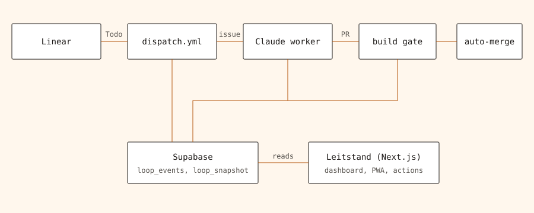

# Leitstand

Gate-Integration für die Aufbauphase prüfen: `DRY_RUN=1 node scripts/loop/aufbauphase-probe.mjs`.
Die Probe führt das echte Auto-Merge-Skript mit simuliertem GitHub aus; sie mergt
nichts und ersetzt keinen Live-Nachweis. CI und Abnahme führen sie automatisch aus.

A mobile-first control room that shows what a fleet of AI agents is building, what it costs, and what needs a human, for one person running several software products.

<!-- Hero screenshot: pending, see "Ausgelassen" in the pull request. Playwright capture belongs to the designer role (SIN-561). -->

## Why

Autonomous coding agents produce pull requests around the clock, but nobody can tell at a glance what is running, stuck, or waiting for approval. Leitstand reads the events the agents write to Supabase (`loop_events`, `loop_snapshot`) and shows only real data: no invented numbers, and Claude quota figures are labelled as estimates. Actions such as approve, run the planner now, or emergency stop run server-side with their own token and are logged. Sign-in is restricted to the owner (magic link, row-level security).

## Architecture



The self-building loop is described in [`docs/decisions/SIN-413-loop.md`](docs/decisions/SIN-413-loop.md); the agent roles in [`docs/ABLAUF.md`](docs/ABLAUF.md).

Dispatcher und Planer lesen offene Linear-Projekt-Issues in Seiten zu 25 mit Cursor-Fortsetzung (SIN-825), damit verschachtelte Abfragen unter dem Komplexitätslimit bleiben.

## Stack

Next.js 16 · React 19 · TypeScript · Supabase (EU) · React Flow · GitHub Actions · Vercel · PWA with web push

## Quick start

```bash
npm ci
cp .env.example .env.local   # fill in the Supabase values, names only in the repo
npm run dev                  # http://localhost:43124
```

Checks: `npm run typecheck`, `npm run lint`, `npm test`, `npm run test:a11y` (Playwright with axe-core, after `npm run build`).

## What I learned

1. A dashboard is only trustworthy if every number has a source row; refusing placeholder statistics shaped the whole data model.
2. Unattended agents need hard gates: a required build check, a bounded number of repair rounds (3), and a human label for risky changes.
3. Quota-limited services need pauses with a reset time (`kontingent_pausen`) instead of blind retries.

## Further docs

- Proposed Context7 documentation access, exact permissions and remaining live acceptance: [`docs/decisions/SIN-537-leitstand-context7.md`](docs/decisions/SIN-537-leitstand-context7.md).
- Role/tool evidence and open acceptance checks: [`docs/autonomy/ROLLEN-ABNAHME.md`](docs/autonomy/ROLLEN-ABNAHME.md); also linked from “Mein Team”. This is a dated assessment, not live telemetry.
- Research CLI: `DRY_RUN=1 npx tsx scripts/autonomy/research.ts SIN-826 "agent tools"` checks startup without network or file writes. Actual searches require both GitHub and public Hugging Face results before writing a decision file; no model API is called.
- Signing in on iPhone (home-screen app, 6-digit code from the mail): [`docs/decisions/SIN-510-code-anmeldung.md`](docs/decisions/SIN-510-code-anmeldung.md)
- Quota pauses: [`docs/decisions/SIN-581-kontingent-pausen.md`](docs/decisions/SIN-581-kontingent-pausen.md)
- Rules for agents working in this repo: [`AGENTS.md`](AGENTS.md)

## License

[MIT](LICENSE)

## PR-Prüfer (SIN-827)

Der vorgeschlagene gehärtete Prüfer lädt seine Implementierung und Abhängigkeiten vom Basis-Commit, liest Claude-/Codex-PRs nur als Diff und nennt den geprüften Commit. CLI: `node --import tsx scripts/pruefer/pruefer.ts <PR-Nummer> <Basis-SHA> <Head-SHA>`. Beide SHAs müssen vollständig sein. `DRY_RUN=1` unterdrückt Modell-/Ledger-Aufrufe. OpenAI-/Anthropic-API-Nutzung ist getrennt von Plus-/Max-Abos; vorhandene API-Konfiguration bleibt erforderlich.

## Claude/Codex-Fallback (SIN-832)

Die vorbereitete [Fallback-Policy](src/lib/loop/fallback.ts) unterscheidet Kontingent-, Auth-, Netzwerk-, Verbindungs- und fachliche Fehler, begrenzt Wiederholungen und erhält vorhandene PRs und Worker-Claims. `node --import tsx src/lib/loop/fallback.test.ts` führt die isolierten Simulationen ohne Modellaufruf aus.

**Dauerhafte Reservierung (SIN-832):** Vor jedem Start reserviert der Dispatcher das Issue per Compare-and-swap in `leitstand_aufgaben` ([reservierung.ts](src/lib/loop/reservierung.ts), Spalten `claim_*`, `reparaturen`). Ohne bestätigte Reservierung startet nichts; Merge, Reparaturstopp und ein belegt verwaister Claim (Wächter: kein PR, kein Spiegel, kein laufender Worker, älter als 6 h) geben sie frei. Reparaturrunden zählen issueweit über PRs und Provider. Die Spalten kommen per Lern-App-Migration (Content-Agent-Lernapp #433) und müssen vor dem Merge angewendet sein.

**Noch kein autonomer Produktionsfallback:** Ein Codex-Startweg fehlt (Kommentar-Eingang meldet Zuordnungsfehler); der Dispatcher startet nur Claude. Linear hält die bisherigen Aufträge. Datei-Proben und simulierte Reservierungen ersetzen keine Live-Abnahme. Belege und Wiederaufnahmebedingungen: [SIN-832-fallback.md](docs/decisions/SIN-832-fallback.md).

**Aktuelle Belege (SIN-854):** Prüfer und Merge-Gate benötigen `LINEAR_API_KEY`, lesen den aktuellen Linear-Auftrag und binden bestandene Review-Belege an Head-SHA und vollständigen Auftragstext. Ein veralteter GitHub-Spiegel ist keine Merge-Grundlage. Worker-PRs mergen nur synchron mit geprüfter Head-SHA und unmittelbar erneut gelesenen Kriterien; es bleibt keine ausstehende Auto-Merge-Freigabe aktiv. Eine echte erneute Review kann mit `pruefer.yml` auf `main`, Eingaben `pr` und `pruefen=true`, angefordert werden; ohne diesen Schalter bleibt der manuelle Lauf trocken. Kontrollierte Gate-/Reparatur-Abnahme ohne externe Modellaufrufe: `node --import tsx --test src/lib/loop/beleg-stand.test.ts src/lib/loop/merge-gate.test.ts src/lib/loop/repair-cli.test.ts`. Aktivierungsgrenzen stehen in [SIN-854](docs/decisions/SIN-854-aktuelle-belege.md).

**Prüfer-Diagnose (SIN-880):** `PRUEFER_PREIS_EIN` und `PRUEFER_PREIS_AUS` sind USD je Million Tokens für die lokale Kostenschätzung, keine Denkzeit- oder API-Preiseinstellung. Für `gpt-6-luna` gelten bei Standardverarbeitung bis 272K Eingabetokens 0.10/0.50; oberhalb davon gelten höhere Tarife. Der Prüfer sendet `reasoning_effort: low` und höchstens 6000 Tokens für Reasoning plus Antwort; die bestehende Budgetschätzung von 0,10 $ rechnet diese Ausgabe mit ein (keine harte Abrechnungssperre). HTTP-Fehler enthalten maximal 300 Zeichen redigierten Antworttext. Leere, ungültige oder am Tokenlimit abgebrochene Antworten scheitern mit benanntem Fehlerort; ein fehlgeschlagener Rückfall nennt beide Ursachen. Offline-Nachweis: `node --import tsx --test src/lib/pruefer/pruefer.test.ts src/lib/pruefer/cli.test.ts`. Erst ein echter Prüfer-Lauf nach Aktivierung belegt die API-Funktion.
