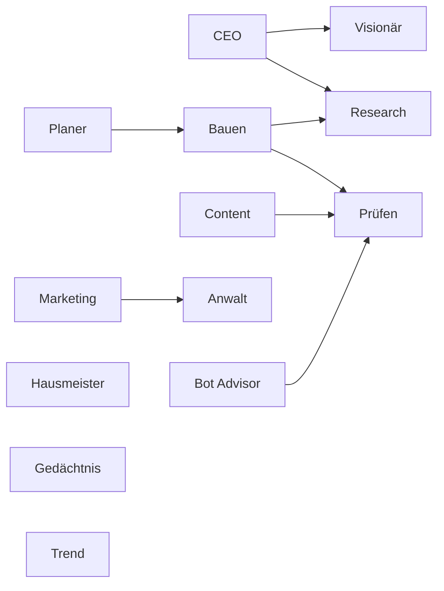

# Ablauf

Erzeugt aus `docs/autonomy/agents.json` (Stand 2026-10-15) mit `npx tsx scripts/autonomy/ablauf.ts`. Nicht von Hand ändern.

Bau-Spuren: Spur A · Claude Max, Spur B · Claude Max, Spur C · API mit Haiku.

| Rolle | Auslöser | Sicherheitsnetz | Werkzeuge |
| -- | -- | -- | -- |
| CEO | täglich | täglich 06:10 | Supabase, Linear, Gedächtnis |
| Visionär | CEO meldet fertig | keins | Linear, Supabase, Gedächtnis |
| Planer | nach jedem Merge; Fertig-Liste ändert sich; Abnahme-Lauf; Schlange unter 3 startbar | täglich 06:00 | Linear, Supabase, Gedächtnis |
| Research | vom CEO oder Bauer angefordert | keins | WebSearch, WebFetch, Context7, Hugging Face Hub API, GitHub-Suche |
| Bauen | Plan des Planers | keins | Bash, Context7, Figma-Skript |
| Prüfen | jeder Push auf einen PR; nach jedem Deploy | keins | Playwright, axe, Langfuse-Scores |
| Content | Plan des Planers | keins | Bash, Langfuse-Scores |
| Marketing | Fertig-Punkt bestätigt; Release | montags | WebFetch, Supabase |
| Hausmeister | alle 20 Merges (merges_seit_hausmeister) | montags 07:00 | Bash, knip |
| Anwalt | PR ändert Migrationen, Tracking, Prompts mit Nutzerdaten, Rechtstexte oder Werbemittel | monatlich AVV-Abgleich | GitHub |
| Gedächtnis | nach jedem Merge | täglich 05:50 | GitHub |
| Bot Advisor | Sinan beschreibt in einem Satz, was automatisiert werden soll | keins | Gedächtnis, Infisical (nur Namen) |
| Trend | sonntags (Bewertung); täglich (Sternzuwachs) | sonntags 04:30, täglich Kurzlauf | GitHub-Suche, Hugging Face Hub API, Release-Seiten, Linear, Supabase |
