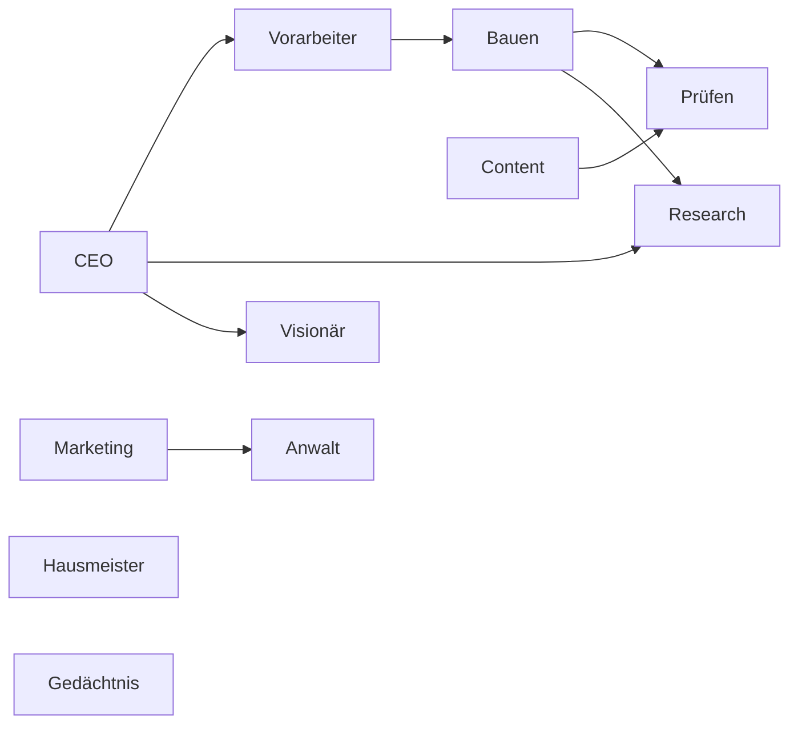

# Ablauf

Erzeugt aus `docs/autonomy/agents.json` (Stand 2026-10-13) mit `npx tsx scripts/autonomy/ablauf.ts`. Nicht von Hand ändern.

Bau-Spuren: Spur A · Claude Max, Spur B · Claude Max, Spur C · API mit Haiku.

| Rolle | Auslöser | Sicherheitsnetz | Werkzeuge |
| -- | -- | -- | -- |
| CEO | Schlange unter 3 startbar; Fertig-Liste ändert sich; Live-Check rot | täglich 06:00 | Supabase, Linear, Gedächtnis |
| Visionär | CEO meldet fertig | keins | Linear, Supabase, Gedächtnis |
| Vorarbeiter | nach jedem Merge; CEO legt Issues an | keins | Linear, Supabase |
| Research | vom CEO oder Bauer angefordert | keins | WebSearch, WebFetch, Context7, Hugging Face Hub API, GitHub-Suche |
| Bauen | Plan des Vorarbeiters | keins | Bash, Context7, Figma-Skript |
| Prüfen | jeder Push auf einen PR; nach jedem Deploy | keins | Playwright, axe, Langfuse-Scores |
| Content | Plan des Vorarbeiters | keins | Bash, Langfuse-Scores |
| Marketing | Fertig-Punkt bestätigt; Release | montags | WebFetch, Supabase |
| Hausmeister | alle 20 Merges (merges_seit_hausmeister) | montags 07:00 | Bash, knip |
| Anwalt | PR ändert Migrationen, Tracking, Prompts mit Nutzerdaten, Rechtstexte oder Werbemittel | monatlich AVV-Abgleich | GitHub |
| Gedächtnis | nach jedem Merge | täglich 05:50 | GitHub |
